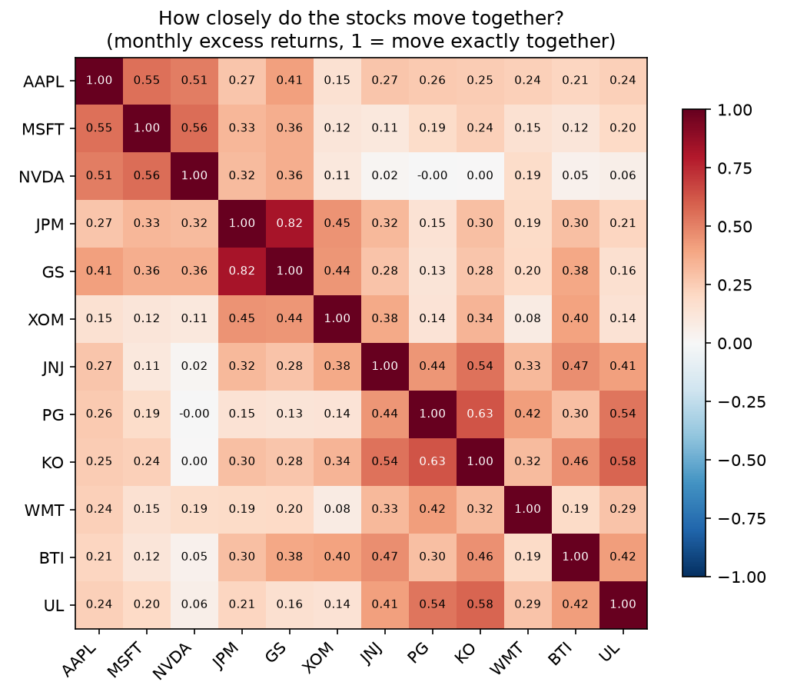
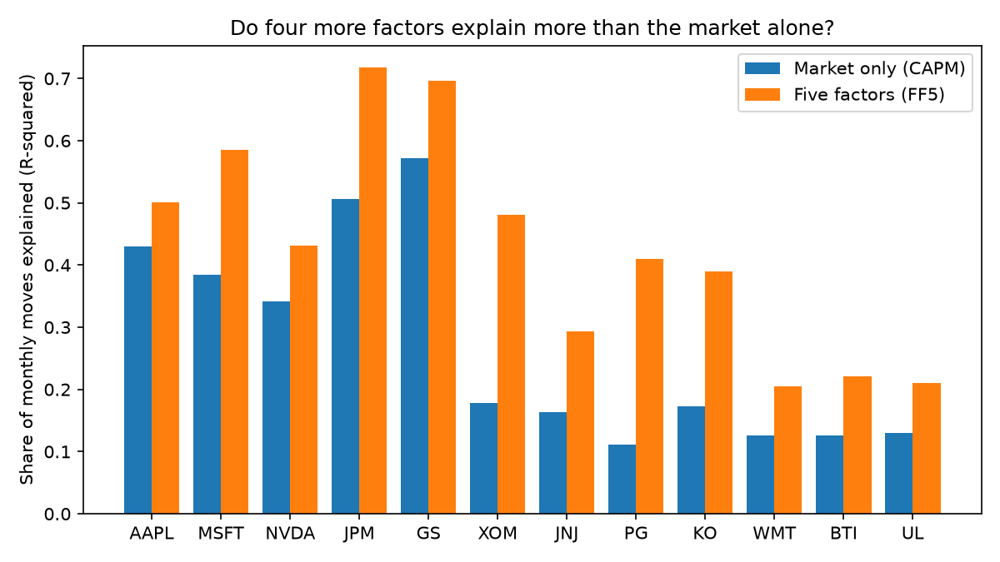
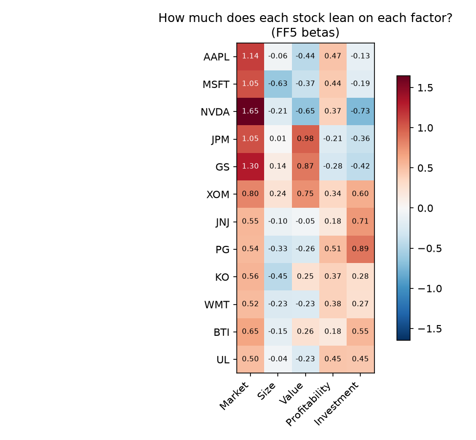
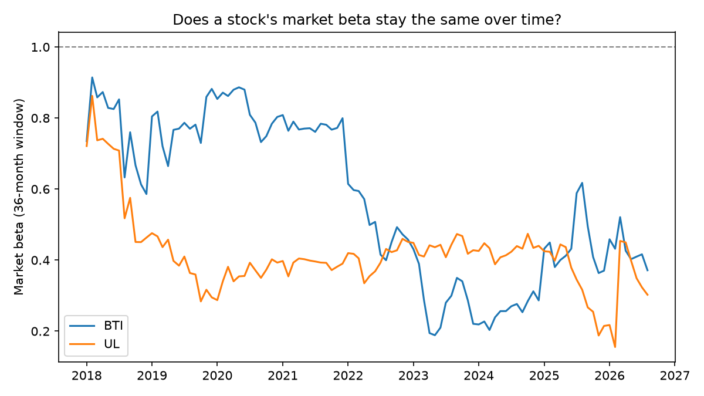

# Stock Returns Factor Analysis

**What drives the monthly returns of a stock? This project tests how much of the answer comes from the overall market, and how much from four other well-known factors.**

It is a small Python project. It downloads 10 years of monthly stock returns for 12 companies, fits two simple regression models for each one, and writes the results as tables, charts and a plain-language summary.

> **Please read first:** this is a learning project. It is not investment advice, and it does not try to predict future prices.

---

## Why I built it

My work so far has been forecasting, market sizing and data analysis in consumer goods. I wanted to practice the same kind of analysis that equity research teams use: measuring what explains a stock's returns, and checking how stable those relationships are over time.

I included **BTI** (British American Tobacco) and **UL** (Unilever) because I worked at both companies and know their markets well. The other ten are large, well-known companies from different sectors.

## The question

> For each stock, how much of its monthly return is explained by (1) the market alone, and (2) the market plus four more factors? And is there any return left over after that?

## What the project does

1. **Gets the data.** Monthly stock returns from Yahoo Finance, and monthly factor returns from the free Fama-French data library.
2. **Lines the data up.** It keeps only the months that exist in both, and subtracts the risk-free rate to get "excess returns".
3. **Fits two models for every stock.**
   - **CAPM:** one factor, the market.
   - **FF5:** five factors, the market, size, value, profitability and investment.
4. **Checks relationships.** A correlation table shows which stocks move together, and a rolling beta shows whether a stock's market sensitivity changes over time.
5. **Writes the results.** Tables (CSV), four charts (PNG) and a short summary in plain words. The results below are filled in automatically from the real run.

## Results

<!-- RESULTS:START -->
### Data used
- Period: 2015-02 to 2026-08 (139 months)
- Stocks (12): AAPL, MSFT, NVDA, JPM, GS, XOM, JNJ, PG, KO, WMT, BTI, UL

### Results table (five-factor model)
| Stock | Market beta | Size | Value | Profitability | Investment | Alpha per year | Alpha p-value | R-squared (CAPM) | R-squared (FF5) |
|---|---|---|---|---|---|---|---|---|---|
| AAPL | 1.14 | -0.06 | -0.44 | 0.47 | -0.13 | 7.8% | 0.14 | 0.43 | 0.50 |
| MSFT | 1.05 | -0.63 | -0.37 | 0.44 | -0.19 | 8.9% | 0.04 | 0.38 | 0.59 |
| NVDA | 1.65 | -0.21 | -0.65 | 0.37 | -0.73 | 40.0% | 0.00 | 0.34 | 0.43 |
| JPM | 1.05 | 0.01 | 0.98 | -0.21 | -0.36 | 7.1% | 0.07 | 0.51 | 0.72 |
| GS | 1.30 | 0.14 | 0.87 | -0.28 | -0.42 | 3.9% | 0.38 | 0.57 | 0.70 |
| XOM | 0.80 | 0.24 | 0.75 | 0.34 | 0.60 | 1.5% | 0.79 | 0.18 | 0.48 |
| JNJ | 0.55 | -0.10 | -0.05 | 0.18 | 0.71 | 3.7% | 0.40 | 0.16 | 0.29 |
| PG | 0.54 | -0.33 | -0.26 | 0.51 | 0.89 | -1.0% | 0.75 | 0.11 | 0.41 |
| KO | 0.56 | -0.45 | 0.25 | 0.37 | 0.28 | 0.7% | 0.86 | 0.17 | 0.39 |
| WMT | 0.52 | -0.23 | -0.23 | 0.38 | 0.27 | 5.5% | 0.26 | 0.13 | 0.20 |
| BTI | 0.65 | -0.15 | 0.26 | 0.18 | 0.55 | -1.1% | 0.85 | 0.13 | 0.22 |
| UL | 0.50 | -0.04 | -0.23 | 0.45 | 0.45 | -1.6% | 0.73 | 0.13 | 0.21 |

### What the numbers say
- The market alone (CAPM) explains 27% of the monthly moves on average. Adding the four other factors (FF5) raises this to 43%.
- Highest market beta: NVDA (1.65). Lowest: UL (0.50). A beta above 1 means the stock tends to move more than the market.
- Most value-tilted (highest Value loading): JPM (0.98). Most growth-tilted (lowest): NVDA (-0.65).
- Alpha (return not explained by the factors) is statistically different from zero at the 5% level for 2 of 12 stocks.
- Stocks that moved most closely together: JPM and GS (0.82). Least: NVDA and PG (-0.00).

### Charts




<!-- RESULTS:END -->

## Tools and skills shown

- **Python:** pandas, NumPy, matplotlib
- **Statistics:** linear regression (OLS), Newey-West standard errors, R-squared, correlation, rolling windows
- **Finance concepts:** excess returns, CAPM, Fama-French five-factor model, alpha and beta
- **Good practice:** automated tests, results written by code (no numbers typed by hand), clear README

## How to run it

```bash
pip install -r requirements.txt
python run_all.py
```

The first run downloads the data into a `data/` folder. After that, the results appear in the `outputs/` folder and in the Results section above.

To check the code itself, run the tests. They use made-up random numbers and need no internet.

```bash
pip install -r requirements-dev.txt
python -m pytest
```

## Project layout

```
run_all.py          runs everything
src/data.py         downloads and lines up the data
src/models.py       the regression models, correlation and rolling beta
src/plots.py        the four charts
src/report.py       writes the summary and fills in this README
tests/              automated tests
outputs/            tables, charts and summary (created when you run it)
```

## Simple glossary

- **Return:** how much a stock went up or down in a month, as a percent.
- **Excess return:** the stock's return minus what a risk-free investment (like a short government bill) paid that month.
- **Factor:** a broad driver of returns shared by many stocks. In this project: **Market** (the whole stock market), **Size** (small companies vs large), **Value** (cheap stocks vs expensive), **Profitability** (strong vs weak profits) and **Investment** (conservative vs aggressive spending).
- **Beta:** how strongly a stock reacts to a factor. A market beta of 1.2 means the stock tends to move 1.2% when the market moves 1%.
- **Alpha:** the part of a stock's return that the factors do not explain.
- **R-squared:** the share of the stock's monthly moves that the model explains (0% to 100%).
- **Correlation:** how closely two stocks move together, from -1 to +1.
- **p-value:** a small p-value (below 0.05) means a result is unlikely to be just luck.

## Limits

- Twelve stocks over about ten years is a small sample. The results describe this sample, not all stocks.
- The models use past data only. They say nothing certain about the future.
- Stock prices come from Yahoo Finance. Please check Yahoo's terms before reusing the price data. For this reason the downloaded data is not stored in this repository, and the code downloads it fresh.
- The factor data comes from the [Kenneth French Data Library](https://mba.tuck.dartmouth.edu/pages/faculty/ken.french/data_library.html).

## About the code

I built this project with help from Claude, an AI coding assistant. I chose the question and the stocks, ran the code, and read the results. The tests check that the regression finds relationships that were planted in made-up data, so the method is checked before it is trusted on real data.

## Author

Muhammad Baqir, MS in Data Science, Duke University. [LinkedIn](http://www.linkedin.com/in/muhammad-baqir) | [GitHub](https://github.com/mbaqirdilawari)

Released under the MIT License.
